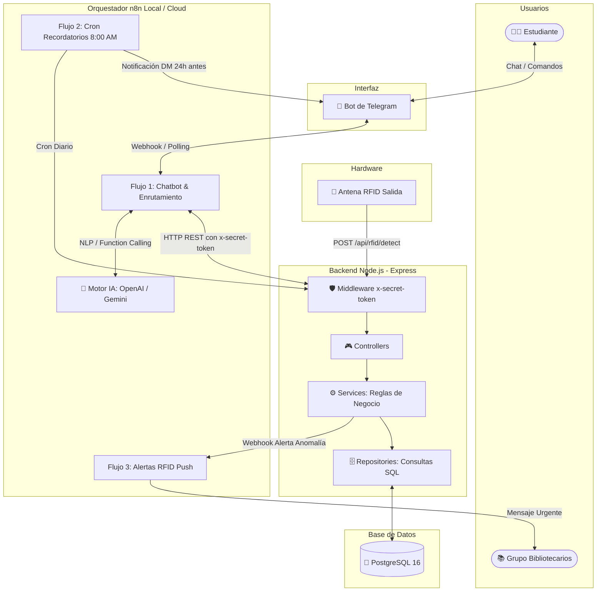

# 🤖 Chatbot de Biblioteca Escolar con IA, n8n y RFID

Bienvenido a la documentación y código fuente del **Chatbot de Asistente Virtual para Biblioteca Escolar (Tuxtla Gutiérrez)**. Este sistema orquesta la atención automatizada a estudiantes a través de **Telegram**, procesamiento de lenguaje natural con **IA (OpenAI/Gemini)**, un **backend modular en Node.js (Express)**, persistencia en **PostgreSQL**, y monitoreo proactivo con **sensores RFID**.

Este proyecto está diseñado con una arquitectura desacoplada para que cualquier miembro del equipo pueda entenderlo, ejecutarlo localmente y extenderlo/integrarlo fácilmente en nuestro **Proyecto X** o desplegarlo en **AWS EC2**.

---

## 📑 Tabla de Contenidos
1. [Arquitectura General del Sistema](#-arquitectura-general-del-sistema)
2. [Estructura del Proyecto](#-estructura-del-proyecto)
3. [Casos de Uso Implementados](#-casos-de-uso-implementados)
4. [Requisitos Previos](#-requisitos-previos)
5. [Guía Rápida de Instalación y Puesta en Marcha](#-guía-rápida-de-instalación-y-puesta-en-marcha)
   - [Opción 1: Todo en Docker Compose (Recomendado)](#opción-1-todo-en-docker-compose-recomendado)
   - [Opción 2: Desarrollo Local (Node.js + PostgreSQL existente de n8n)](#opción-2-desarrollo-local-nodejs--postgresql-existente-de-n8n)
6. [Configuración del Bot en Telegram](#-configuración-del-bot-en-telegram)
7. [Configuración e Importación de Flujos en n8n](#-configuración-e-importación-de-flujos-en-n8n)
8. [Especificación de la API REST (Endpoints)](#-especificación-de-la-api-rest-endpoints)
9. [Simulación y Pruebas del Sistema (RFID y Préstamos)](#-simulación-y-pruebas-del-sistema-rfid-y-préstamos)
10. [Guía para Integrar en "Proyecto X"](#-guía-para-integrar-en-proyecto-x)
11. [Recomendaciones para Despliegue en AWS EC2](#-recomendaciones-para-despliegue-en-aws-ec2)

---

## 🏛️ Arquitectura General del Sistema

El sistema implementa una arquitectura por capas modular y desacoplada:



---

## 📁 Estructura del Proyecto

Siguiendo el estándar del documento de arquitectura, el backend separa estrictamente las responsabilidades:

```text
Chatbt-Josias/
├── database/
│   └── init.sql                  # Esquema DDL (tablas, índices) y datos iniciales de prueba (seeds)
├── n8n-workflows/
│   ├── 01_chatbot_principal_telegram.json  # Flujo n8n: Telegram + IA + Consultas API
│   ├── 02_cron_recordatorios_prestamos.json# Flujo n8n: Cron diario para avisar vencimientos a estudiantes
│   └── 03_alerta_rfid_bibliotecarios.json  # Flujo n8n: Alerta instantánea a grupo privado por RFID
├── scripts/
│   ├── init-db.js                # Script auxiliar para inicializar tablas en PostgreSQL
│   └── test-api.js               # Script de pruebas automatizadas para todos los endpoints
├── src/
│   ├── config/
│   │   ├── db.js                 # Pool de conexiones pg para PostgreSQL
│   │   └── env.js                # Carga y validación de variables de entorno
│   ├── controllers/              # Procesan requests HTTP de n8n o hardware y responden en JSON
│   │   ├── book.controller.js
│   │   ├── loan.controller.js
│   │   └── rfid.controller.js
│   ├── services/                 # Lógica de negocio (reglas de multas, renovaciones, RFID)
│   │   ├── book.service.js
│   │   ├── loan.service.js
│   │   └── rfid.service.js
│   ├── repositories/             # Interacción exclusiva con PostgreSQL (consultas SQL directas)
│   │   ├── book.repository.js
│   │   ├── loan.repository.js
│   │   ├── student.repository.js
│   │   └── rfid.repository.js
│   ├── routes/                   # Definición de rutas y endpoints de Express
│   │   ├── book.routes.js
│   │   ├── loan.routes.js
│   │   ├── rfid.routes.js
│   │   └── index.js
│   ├── middlewares/
│   │   ├── auth.middleware.js    # Validación estricta del header 'x-secret-token'
│   │   └── error.middleware.js   # Manejo estandarizado de errores (400, 404, 500)
│   ├── app.js                    # Configuración de Express
│   └── server.js                 # Inicialización del servidor HTTP
├── .env.example                  # Plantilla de variables de entorno
├── Dockerfile                    # Contenerización del backend Node.js
├── docker-compose.yml            # Orquestación de Node.js + PostgreSQL + n8n
├── package.json
└── README.md
```

---

## 🎯 Casos de Uso Implementados

### 1. Para los Estudiantes (Vía Telegram)
* **Búsqueda Inteligente de Acervo:** Consulta de disponibilidad física o digital con lenguaje natural (ej. *"¿Tienen libros de cálculo de Stewart?"*). El sistema devuelve el estante exacto (ej. `Pasillo 2 - Estante 4A`), si está disponible y enlace a versión digital si existe.
* **Estado de Préstamos (`/mis_prestamos`):** Muestra los libros que tiene el alumno, fechas de vencimiento, días restantes y alerta si tiene multas pendientes.
* **Renovación Digital:** Solicita extensión de 7 días directamente desde el chat. Aplica validaciones:
  * ❌ Rechaza si el alumno tiene multas pendientes en la biblioteca.
  * ❌ Rechaza si ya alcanzó el máximo de 2 renovaciones permitidas.
  * ❌ Rechaza si el libro ya está vencido (requiere entrega física).

### 2. Para el Sistema y Bibliotecarios (Notificaciones Proactivas)
* **Recordatorios de Devolución (Cron 8:00 AM):** n8n consulta qué préstamos vencen mañana (en 24 horas) y envía automáticamente un mensaje directo a su Telegram para evitar recargos.
* **Alerta de Seguridad RFID:** Cuando la antena física en la puerta detecta una etiqueta RFID saliendo, el backend verifica si cuenta con préstamo activo:
  * Si cuenta con préstamo activo: Registra salida autorizada.
  * Si **NO** cuenta con préstamo registrado: El backend detecta la anomalía y dispara un webhook a n8n, el cual envía inmediatamente una alerta crítica con sirenas al grupo privado de bibliotecarios.

---

## 📦 Requisitos Previos

* **Docker & Docker Compose** (instalado en tu máquina o servidor).
* **Node.js** v18 o superior (si deseas correr el backend fuera de Docker).
* Cuenta de **Telegram** para crear el bot con `@BotFather`.
* Cuenta de **OpenAI** (API Key) o **Google Gemini** para la extracción de intenciones de lenguaje natural en n8n.

---

## 🚀 Guía Rápida de Instalación y Puesta en Marcha

### Opción 1: Todo en Docker Compose (Recomendado para el equipo)

Este repositorio incluye un `docker-compose.yml` unificado que levanta **PostgreSQL 16** (con tablas y datos cargados automáticamente), la **API de Node.js** y **n8n**:

1. Clona el repositorio y entra a la carpeta:
   ```bash
   cd Chatbt-Josias
   ```
2. Crea el archivo de variables `.env` a partir de la plantilla:
   ```bash
   cp .env.example .env
   ```
3. Inicia los contenedores:
   ```bash
   docker compose up -d --build
   ```
4. Comprueba los servicios activos:
   * **API de Node.js:** [http://localhost:3000/api/health](http://localhost:3000/api/health)
   * **n8n:** [http://localhost:5678](http://localhost:5678)
   * **PostgreSQL:** `localhost:5432` (usuario: `n8n`, contraseña: `n8n_password`, BD: `n8n`)

---

### Opción 2: Desarrollo Local (Node.js + PostgreSQL de n8n)

Si ya levantaste n8n en `C:\n8n-local>` con `docker compose up -d`, asegúrate de que el puerto de PostgreSQL esté mapeado al host. En tu `docker-compose.yml` de n8n agrega `ports: - "5432:5432"` bajo el servicio `postgres`:

```yaml
  postgres:
    image: postgres:16
    restart: always
    ports:
      - "5432:5432"
    environment:
      - POSTGRES_USER=n8n
      - POSTGRES_PASSWORD=n8n_password
      - POSTGRES_DB=n8n
```
Reinicia con: `docker compose up -d`.

Luego, en esta carpeta del proyecto:
1. Instala dependencias:
   ```bash
   npm install
   ```
2. Inicializa las tablas y datos de prueba:
   ```bash
   npm run db:init
   ```
3. Inicia el servidor de desarrollo con recarga automática:
   ```bash
   npm run dev
   ```

---

## 🤖 Configuración del Bot en Telegram

1. Abre Telegram y busca a **`@BotFather`**.
2. Envía el comando `/newbot`.
3. Asigna un nombre al bot (ej. `Biblioteca Tuxtla Bot`) y un usuario que termine en `bot` (ej. `BibliotecaTuxtla_bot`).
4. `@BotFather` te entregará un **Token HTTP API** (ej. `7123456789:AAFq_xxxxxxxxxxxxxxxxxxxxxxxxxxx`). Guárdalo.
5. Configura los comandos visibles en Telegram enviando a `@BotFather` el comando `/setcommands` y pegando la siguiente lista:
   ```text
   start - Iniciar el asistente virtual de la biblioteca
   mis_prestamos - Consultar el estado de mis libros y multas
   ayuda - Información de contacto y uso del sistema
   ```

---

## ⚡ Configuración e Importación de Flujos en n8n

1. Entra a tu navegador en **[http://localhost:5678](http://localhost:5678)**.
2. Completa el registro inicial de tu cuenta de administrador en n8n.
3. Ve a **Credentials** en el menú izquierdo:
   * Crea una credencial **Telegram API** y pega el token que te dio `@BotFather`.
   * Crea una credencial **OpenAI API** o **Google Gemini API** para los nodos de IA.
4. Importa los flujos listos desde la carpeta `n8n-workflows/`:
   * Haz clic en **Workflows** -> **Import from File**.
   * Selecciona **`01_chatbot_principal_telegram.json`**:
     * Asocia la credencial de Telegram al nodo *Telegram Trigger* y a los nodos de respuesta.
     * En el nodo de IA, selecciona tu modelo (ej. `gpt-4o-mini` o `gemini-1.5-flash`).
     * Activa el flujo (Toggle en **Active**).
   * Importa **`02_cron_recordatorios_prestamos.json`**:
     * Flujo cron que a las 8:00 AM dispara recordatorios por Telegram.
   * Importa **`03_alerta_rfid_bibliotecarios.json`**:
     * Recibe eventos de la antena RFID y envía la alerta al chat grupal de los bibliotecarios.

> [!NOTE]
> **Webhooks de Telegram en Local:**
> Telegram requiere una URL pública con HTTPS para sus webhooks. Durante el desarrollo local puedes usar **ngrok** (`ngrok http 5678`) o una **Cloudflare Tunnel** (`cloudflared tunnel --url http://localhost:5678`), y configurar esa URL en la variable `WEBHOOK_URL` de n8n. Alternativamente, el nodo Telegram Trigger en n8n puede configurarse en modo polling para pruebas locales sin exponer puertos.

---

## 📡 Especificación de la API REST (Endpoints)

Todas las rutas privadas requieren el header de seguridad:
`x-secret-token: clave_secreta_compartida_n8n_node`

### 1. Healthcheck
* **Método / URL:** `GET /api/health`
* **Acceso:** Público
* **Respuesta:**
  ```json
  {
    "status": "UP",
    "service": "gestor-biblioteca-api",
    "timestamp": "2026-10-21T01:00:00.000Z"
  }
  ```

---

### 2. Búsqueda de Libros
* **Método / URL:** `GET /api/bot/books?query={termino}`
* **Headers:** `x-secret-token: clave_secreta_compartida_n8n_node`
* **Ejemplo cURL:**
  ```bash
  curl -X GET "http://localhost:3000/api/bot/books?query=calculo" \
       -H "x-secret-token: clave_secreta_compartida_n8n_node"
  ```
* **Respuesta Exitosa (200 OK):**
  ```json
  {
    "success": true,
    "statusCode": 200,
    "data": {
      "totalFound": 2,
      "query": "calculo",
      "books": [
        {
          "id": 1,
          "title": "Cálculo de Una Variable: Trascendentes Tempranas",
          "author": "James Stewart",
          "category": "Matemáticas",
          "availableCopies": 2,
          "isAvailable": true,
          "locationShelf": "Pasillo 2 - Estante 4A",
          "isDigital": true,
          "digitalUrl": "https://biblioteca.escuela.edu.mx/digital/stewart-calculo",
          "statusText": "✅ Disponible (2 ejemplares en Pasillo 2 - Estante 4A)"
        }
      ]
    }
  }
  ```

---

### 3. Consultar Préstamos de un Estudiante
* **Método / URL:** `GET /api/bot/loans/status?telegram_id={chat_id}`
* **Headers:** `x-secret-token: clave_secreta_compartida_n8n_node`
* **Respuesta Exitosa (200 OK):**
  ```json
  {
    "success": true,
    "data": {
      "registered": true,
      "student": {
        "code": "EST-202401",
        "name": "Josias Ramos",
        "hasPenalty": false,
        "penaltyAmount": 0
      },
      "loansCount": 1,
      "loans": [
        {
          "loanId": 1,
          "bookTitle": "Cálculo de Una Variable: Trascendentes Tempranas",
          "dueDate": "2026-10-22",
          "daysRemaining": 1,
          "renewalsMade": 0,
          "maxRenewals": 2,
          "canRenew": true,
          "status": "⏰ Vence muy pronto"
        }
      ]
    }
  }
  ```

---

### 4. Renovar Préstamo Digitalmente
* **Método / URL:** `POST /api/bot/loans/renew`
* **Headers:** `x-secret-token: clave_secreta_compartida_n8n_node`, `Content-Type: application/json`
* **Body:**
  ```json
  {
    "telegram_id": "123456789",
    "book_title": "Cálculo de Una Variable"
  }
  ```
* **Respuesta Exitosa (200 OK):**
  ```json
  {
    "success": true,
    "data": {
      "success": true,
      "message": "¡Renovación exitosa! Se extendió el préstamo de \"Cálculo de Una Variable\" por 7 días adicionales.",
      "bookTitle": "Cálculo de Una Variable: Trascendentes Tempranas",
      "newDueDate": "2026-10-29",
      "renewalNumber": 1,
      "maxRenewalsAllowed": 2
    }
  }
  ```

---

### 5. Consultar Préstamos por Vencer (Para Cron de n8n)
* **Método / URL:** `GET /api/bot/loans/expiring-soon`
* **Headers:** `x-secret-token: clave_secreta_compartida_n8n_node`
* **Respuesta:**
  ```json
  {
    "success": true,
    "data": {
      "count": 1,
      "expiringLoans": [
        {
          "loanId": 1,
          "telegramId": "123456789",
          "studentName": "Josias Ramos",
          "bookTitle": "Cálculo de Una Variable: Trascendentes Tempranas",
          "dueDate": "2026-10-22"
        }
      ]
    }
  }
  ```

---

### 6. Simulación de Detección en Antena RFID
* **Método / URL:** `POST /api/rfid/detect`
* **Headers:** `x-secret-token: clave_secreta_compartida_n8n_node`, `Content-Type: application/json`
* **Body:**
  ```json
  {
    "rfid_tag": "RFID-SEARS-FISICA-001",
    "antenna_id": "ANTENA_SALIDA_PRINCIPAL"
  }
  ```
* **Respuesta (Alerta de Seguridad - Anomalía):**
  ```json
  {
    "success": true,
    "data": {
      "alertTriggered": true,
      "reason": "SIN_PRESTAMO_ACTIVO",
      "rfidTag": "RFID-SEARS-FISICA-001",
      "antennaId": "ANTENA_SALIDA_PRINCIPAL",
      "book": {
        "title": "Física Universitaria con Física Moderna",
        "author": "Sears y Zemansky",
        "locationShelf": "Pasillo 3 - Estante 1A"
      },
      "message": "🚨 ALERTA DE SEGURIDAD RFID: El libro \"Física Universitaria con Física Moderna\" está saliendo sin registrar préstamo."
    }
  }
  ```

---

## 🧪 Simulación y Pruebas del Sistema

Puedes correr la suite de pruebas automatizada que valida cada endpoint y caso de uso:

```bash
npm test
```

Este comando probará:
1. Verificación de salud del servidor.
2. Rechazo 401 Unauthorized sin `x-secret-token`.
3. Búsqueda de libros por lenguaje natural.
4. Consulta de préstamos y verificación de multas.
5. Reglas de renovación (incremento de días y límite).
6. Endpoint para el Cron de n8n (préstamos que vencen en 24h).
7. Detección de salida no autorizada con sensor RFID.

---

## 🧩 Guía para Integrar en "Proyecto X"

Para integrar este chatbot en el proyecto principal que desarrollará el equipo:

1. **Como Microservicio Independiente:**
   * Mantener este repositorio corriendo como un servicio Docker en su propia red o red compartida (`docker network connect`).
   * Tu aplicación principal puede consumir directamente los endpoints de `/api/bot/*` y `/api/rfid/*` pasando el header `x-secret-token`.
2. **Como Módulo en el Backend Principal:**
   * Los archivos en `src/repositories/` y `src/services/` están 100% desacoplados de Express. Pueden importarse en cualquier arquitectura (NestJS, Fastify o Express) conservando exactamente la misma lógica de negocio y consultas SQL.
3. **Sincronización de Usuarios:**
   * El endpoint `POST /api/bot/students/register` permite que tu sistema web registre automáticamente el `telegram_id` del alumno cuando inicie sesión en el portal de estudiantes.

---

## ☁️ Recomendaciones para Despliegue en AWS EC2

De acuerdo a las especificaciones del documento (Página 3):

1. **Security Groups en AWS EC2:**
   * Abrir puerto `22` (SSH - solo tu IP).
   * Abrir puerto `80` (HTTP) y `443` (HTTPS) para el tráfico web y webhooks de Telegram.
   * **IMPORTANTE:** No expongas el puerto `5678` (n8n) ni el `5432` (PostgreSQL) directamente a internet.
2. **Reverse Proxy con Nginx y Certificado SSL:**
   * Telegram exige obligatoriamente HTTPS con un certificado SSL válido para recibir webhooks.
   * Configura Nginx para redirigir:
     * `bot.tudominio.edu.mx` -> `http://localhost:5678` (n8n)
     * `api.tudominio.edu.mx` -> `http://localhost:3000` (Node.js API)
   * Obtén certificados SSL gratuitos usando **Certbot**:
     ```bash
     sudo certbot --nginx -d bot.tudominio.edu.mx -d api.tudominio.edu.mx
     ```
3. **Gestión de Secretos en EC2:**
   * Mantén las credenciales en el archivo `.env` del servidor en producción, asegurándote de que los permisos sean restrictivos (`chmod 600 .env`).
